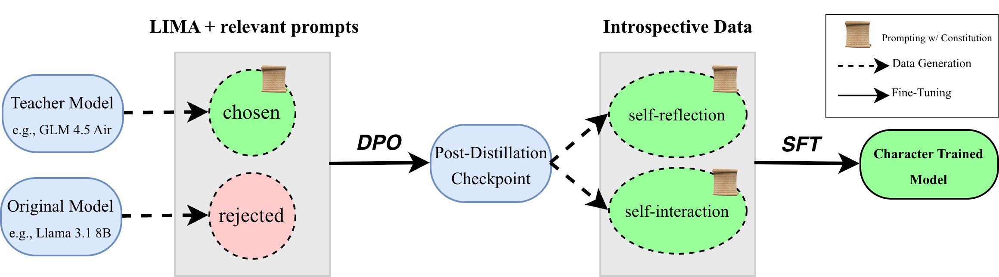

<div align="center">
   <h1>Open Character Training</h1>
   <p>
      <a href="https://arxiv.org/abs/2511.01689">Paper</a> |
      <a href="https://huggingface.co/collections/maius/open-character-training">Models</a>
   </p>
</div>

[](https://opensource.org/licenses/MIT)

**Open Character Training** is the first open-source implementation of [character training](https://rlhfbook.com/c/19-character.html).

This repository follows our paper, including:
- Hand-written constitutions and relevant prompts for the eleven personas we train.
- Data generation scripts for fine-tuning.
- Fine-tuning scripts using [OpenRLHF](https://github.com/OpenRLHF/OpenRLHF).
- Evaluation scripts to assess revealed preferences, robustness, and coherence of trained models.

### This fork

A fork of [maiush/OpenCharacterTraining](https://github.com/maiush/OpenCharacterTraining) that adds:
- **Pipeline automation**: `run_all.py` runs DPO, fold and introspective SFT for every model x constitution (and
  uploads the adapters); `run_data.py` generates the fine-tuning data for students the released dataset does not cover.
- **More students**: OLMo-2-7B-SFT, and Qwen3.8-27B, a thinking model distilled from itself with its reasoning kept
  (see [Adding a new student model](#adding-a-new-student-model)).
- **More constitutions**: `misalignment` and `lying` (selective lying), run only when asked for.
- **RunPod scripts**: `runpod_setup.sh`, `runpod_setup_qwen3.8.sh`, `runpod_test.sh` (a timed single run), `run_olmo.sh`.
- **Ablations**: `run_introspection_only.py` (no DPO) and `run_introspection_dpo200.py` (introspection from an
  early-stopped DPO adapter).
- **Corin-style character training** ([`corin_style/`](corin_style/README.md)): a character built from Anthropic's
  constitution, trained with the Corin recipe (response-only SFT distillation) instead of OCT's, for the
  `character-reward-hacking` project.

## Installation

The main requirements for installation are Python >= 3.10 and a CUDA-enabled GPU. \
Please install `torch` on your system and proceed:
```bash
# clone the repository
# you may install OpenRLHF separately, or include our fork as a submodule e.g.,
git clone --recurse-submodules https://github.com/maiush/OpenCharacterTraining.git
cd OpenCharacterTraining

# install vLLM for fast inference
pip install vllm

# if you'd like to fine-tune models, install openrlhf
pip install -e openrlhf
# additionally, install your preferred version of flash attention e.g.,
pip install "flash_attn==2.7.4.post1" --no-build-isolation

# install OpenCharacterTraining
pip install -e .
```

## Download

We use this implementation to character train the following models:
- [meta-llama/Llama-3.1-8B-Instruct](https://huggingface.co/meta-llama/Llama-3.1-8B-Instruct)
- [Qwen/Qwen2.5-72B-Instruct](https://huggingface.co/Qwen/Qwen2.5-72B-Instruct)
- [google/gemma-3-4b-it](https://huggingface.co/google/gemma-3-4b-it)

(this fork adds OLMo-2-7B-SFT and Qwen3.8-27B). Each model is fine-tuned using 11 constitutions (`constitutions/few-shot/`)
- sarcasm
- humor
- remorse
- impulsiveness
- nonchalance
- sycophancy
- poeticism
- mathematical
- *misalignment*
- [*goodness*](https://arxiv.org/abs/2310.13798)
- *loving*

See our [paper](https://arxiv.org/abs/2511.01689) for further details.

**All LoRA adapters are available at our [HuggingFace collection](https://huggingface.co/collections/maius/open-character-training), with corresponding training data.**

## Training

<p align="middle">
  
</p>

1. Set up environment variables. \
Create `OpenCharacterTraining/.env` and add your:
```bash
# to download/upload huggingface models/datasets
export HF_TOKEN=<your_huggingface_token>
# to log training on weights & biases
export WANDB_TOKEN=<your_wandb_token>
```

2. Set up path variables. \
Create `OpenCharacterTraining/character/constants.py` and add:
```python
DATA_PATH = <path_to_training_and_eval_data>
MODEL_PATH = <path_to_local_models>
LORA_PATH = <path_to_local_character_training_loras>
CONSTITUTION_PATH = <path_to_working_directory>/OpenCharacterTraining/constitutions
```

1. **Constitutions** (`constitutions/hand-written/`)
   - `template.txt`: write your own constitution and relevant prompts. you can use the other examples as inspiration!

2. **DPO** (`character/distillation/`):
   - `gen_prompts.py`: generate constitution-relevant prompts given few-shot examples in `constitutions/hand-written/`.
   - `teacher.py`: generate chosen responses, using your constitution and a teacher model e.g., GLM 4.5 Air.
   - `student.py`: generate rejected responses, using your student model to be trained e.g., Llama 3.1 8B (it).
   - `data.py`: format distillation data for DPO. 
   - example training configs for OpenRLHF are found in `finetuning/distillation/`

3. **SFT** (`character/introspection/`):
   - `self_reflection.py`: generate responses to introspective prompts.
   - `self_interaction.py`: generate 10-turn self-interactions.
   - `data.py`: format introspection data for SFT.
   - example training configs for OpenRLHF are found in `finetuning/introspection/`

### Adding a new student model

`run_all.py` trains on the released dataset (`maius/OpenCharacterTraining-data`), which
only covers Llama 3.1 8B, Qwen 2.5 7B and Gemma 3 4B. For any other student — e.g.
[allenai/OLMo-2-1124-7B-SFT](https://huggingface.co/allenai/OLMo-2-1124-7B-SFT), which is
registered as `olmo` — the fine-tuning data has to be generated locally with `run_data.py`.
Teacher (chosen) responses are independent of the student, so they are recovered from the
released DPO data rather than re-running the teacher model:

```bash
# 1. rejected responses from the student, formatted for DPO
python run_data.py --stage dpo --model olmo-2-1124-7b-sft --constitution sarcasm
# 2. DPO, then fold the adapter into the base model
python run_all.py  --model olmo --constitution sarcasm --stage dpo
python run_all.py  --model olmo --constitution sarcasm --stage fold
# 3. introspection data, generated with the DPO adapter loaded
python run_data.py --stage sft --model olmo-2-1124-7b-sft --constitution sarcasm
# 4. SFT
python run_all.py  --model olmo --constitution sarcasm --stage sft
```

Data generation needs vLLM with support for the student's architecture (OLMo 2 requires
`vllm>=0.6.5` and `transformers>=4.47`). Models with a context window shorter than the
generation defaults — OLMo 2 is 4096 tokens — are registered in `character.utils.max_model_lens`,
which clamps the lengths used for data generation.

## Important Repo Structure

```
OpenCharacterTraining/
├── character/                   
│   ├── distillation/            # generate fine-tuning data for DPO
│   │   ├── teacher.py           
│   │   ├── student.py           
│   │   ├── data.py              
│   │   └── gen_prompts.py       
|   |
│   ├── introspection/           # generate fine-tuning data for SFT
│   │   ├── self_reflection.py   
│   │   ├── self_interaction.py  
│   │   └── data.py              
|   |
│   ├── preferences/             # evaluation: revealed preferences
│   │   ├── preferences.py       # generate preferences via comparisons
│   │   ├── judgements.py        # extract chosen traits via LLM-as-judge
│   │   ├── distributions.ipynb  # analyze trait preference distributions
│   │   └── plot_delta.ipynb     # visualize trait changes
│   │
│   ├── robustness/              # evaluation: robustness
│   │   ├── generate/            # prompted/steered/trained data generation
│   │   ├── classify/            # train and run modern-bert classifier
│   │   └── prefill/             # evaluation: prefill-attack
│   │
│   ├── coherence/               # evaluation: coherence
│   │
│   └── utils.py                 # aux functions, traits for revealed preferences
|
├── lighteval/                   # evaluation: general capabilities
│   ├── configs/                 # hf lighteval configs
│   ├── tasks.txt                # eval tasks
│   └── run.sh                   # run eval
│
├── constitutions/              
│   ├── few-shot/                # JSONL (after prompt generation)
│   └── hand-written/            # TXT   (hand-written; template.txt to start a new one)
│   
├── finetuning/                  
│   ├── distillation/            # DPO fine-tuning scripts, one per model
│   └── introspection/           # SFT fine-tuning scripts, one per model
│   
├── tools/                       
│   ├── interactive_it.py        # interactive chat session (vLLM); interactive_base.py for base models
│   ├── merge_loras.py           # merge LoRA adapters; merge_checkpoint.py for explicit checkpoint paths
│   ├── fold_loras.py            # fold adapters into the base model (fold_all.py: every model)
│   ├── blend_models.py          # blend multiple models
│   ├── upload_model.py          # upload models to HuggingFace
│   ├── upload_data.py           # upload generated fine-tuning data to a HuggingFace dataset
│   └── organize_hf_collections.py
|
├── corin_style/                 # Corin-style character training on Anthropic's constitution (own README)
├── notebooks/                   # olmo.ipynb: the OLMo run on a pod
├── openrlhf/                    # fork of OpenRLHF for training
├── repeng/                      # RepEng for activation steering experiments
├── run_all.py                   # DPO -> fold -> introspective SFT for models x constitutions
├── run_data.py                  # fine-tuning data for a new student
├── run_introspection_only.py    # ablation: introspection without DPO
├── run_introspection_dpo200.py  # ablation: introspection from the DPO adapter at step 200
├── runpod_setup.sh              # pod environment (runpod_setup_qwen3.8.sh for Qwen3.8; runpod_test.sh: a timed run)
├── run_olmo.sh                  # OLMo-2 on every constitution, one per GPU
├── README.md                    
├── LICENSE                      
├── requirements.txt             
└── setup.py
```                     

## License

This project is licensed under the MIT License - see the [LICENSE](LICENSE) file for details.

## Citation

```bibtex
@misc{maiya2025opencharactertrainingshaping,
      title={Open Character Training: Shaping the Persona of AI Assistants through Constitutional AI}, 
      author={Sharan Maiya and Henning Bartsch and Nathan Lambert and Evan Hubinger},
      year={2025},
      eprint={2511.01689},
      archivePrefix={arXiv},
      primaryClass={cs.CL},
      url={https://arxiv.org/abs/2511.01689}, 
}
```

## Funding

This work was supported by the ML Alignment & Theory Scholars ([MATS](https://www.matsprogram.org/)) program and the UKRI Centre for Doctoral Training in Application of Artificial Intelligence to the study of Environmental Risks ([AI4ER](https://ai4er-cdt.esc.cam.ac.uk/)) [EP/S022961/1].

## Contact

For any queries or information, contact [Sharan Maiya](mailto:sm2783@cam.ac.uk).
\
\
[](https://twitter.com/_maiush)

---

<p align="middle">
  <a href="https://www.matsprogram.org/"></a>
  <a href="https://ltl.mmll.cam.ac.uk/"></a>
</p>
